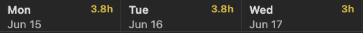
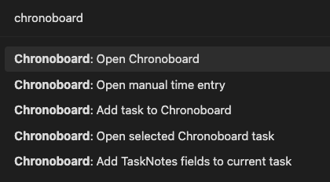

# Chronoboard Changelog

## 0.8.0

### Added

- Added a CSV export modal with a date range, task selection, per-task totals, a saved vault folder, and duplicate-file validation.
- Added an `Export tracked time as CSV` command.
- Added compressed CSV output with tasks in columns, dates in rows, and totals in the second row.

### Changed

- The question mark and the `Open Chronoboard guide` command now show help in a modal.
- The `Stats`, `Task`, and `Totals` controls now use the accent color only when they are active.
- The Stats control now returns to the week view when it is selected again.
- Export tasks are now sorted from most tracked time to least tracked time.

### Fixed

- Chronoboard no longer creates a getting started note or a changelog note in the vault.
- Chronoboard no longer opens a guide or changelog during startup.
- The export task list now updates only after the user selects a date.
- Removed divider lines from the CSV export modal.

## 0.7.0

### Added

- Managed vault notes for:
  - `Getting Started With Chronoboard`
  - `Chronoboard - Changelog`
- Command palette actions for opening the guide and changelog
- Toolbar help button for opening the Chronoboard guide
- Time entry note template support
- Better onboarding guidance around status frontmatter and task setup

### Improved

- Time entry notes can be renamed safely and reopened through Chronoboard entry IDs and aliases
- Totals sorting control now supports multiple sort modes through a compact icon trigger
- Documentation and onboarding flow for first install and plugin updates
- Header totals presentation in Chronoboard summary and week views

### Fixed

- Time entry note creation no longer duplicates conflicting frontmatter keys from templates
- Deleted time entry notes now correctly show `Create time entry note` instead of `Open time entry note`
- Template note resolution now supports normal Obsidian-style paths with or without `.md`

### Clarified Interactions

- Double click a time block to remove it
- Hold and drag a time block to move it
- Use `Ctrl+Z` or `Cmd+Z` to undo block creation or removal
- Removing a task from the left rail does not remove existing tracked time from the board

### Release visuals

## 0.6.2

### Added

- Managed vault notes for:
  - `Getting Started With Chronoboard`
  - `Chronoboard - Changelog`
- Command palette actions for opening the guide and changelog
- Toolbar help button for opening the Chronoboard guide
- Time entry note template support

### Improved

- Time entry notes can be renamed safely and reopened through Chronoboard entry IDs and aliases
- Totals sorting control now supports multiple sort modes through a compact icon trigger
- Documentation and onboarding flow for first install and plugin updates

### Fixed

- Time entry note creation no longer duplicates conflicting frontmatter keys from templates
- Deleted time entry notes now correctly show `Create time entry note` instead of `Open time entry note`
- Template note resolution now supports normal Obsidian-style paths with or without `.md`

### Clarified Interactions

- Double click a time block to remove it
- Hold and drag a time block to move it
- Use `Ctrl+Z` or `Cmd+Z` to undo block creation or removal
- Removing a task from the left rail does not remove existing tracked time from the board
