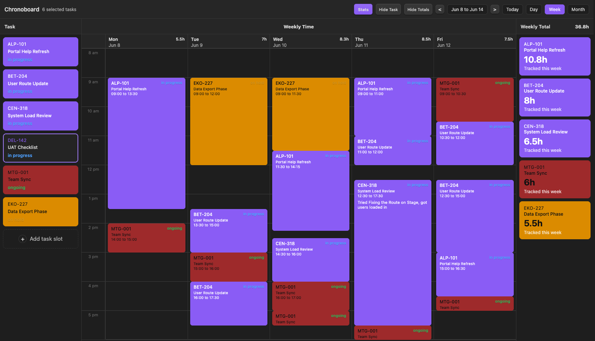
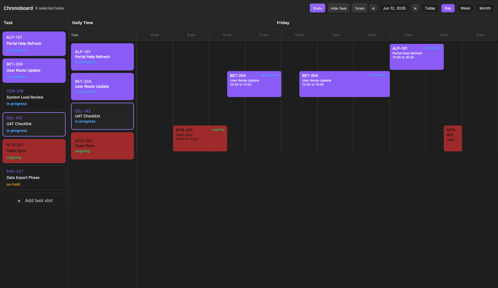
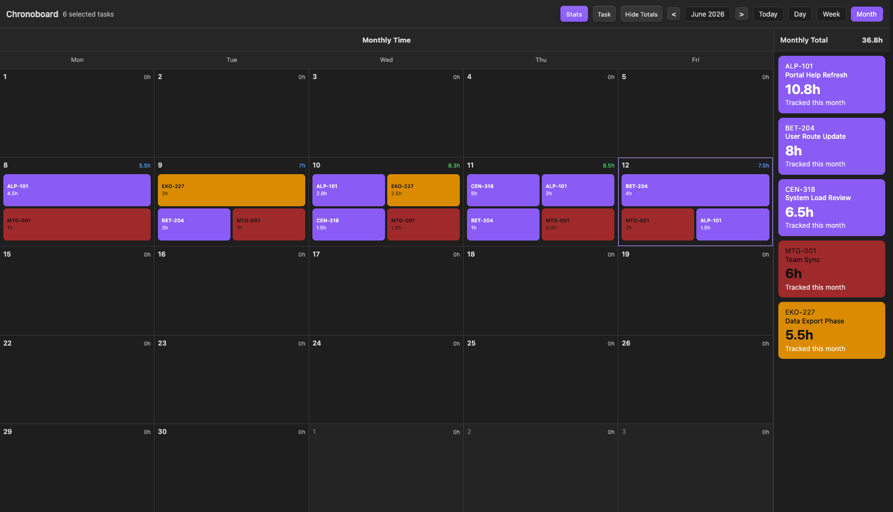

# Chronoboard

Chronoboard is an Obsidian community plugin for visual, task-native time tracking.

It turns Markdown tasks into draggable time blocks across day, week, and month views while writing time data back into frontmatter. Chronoboard works well with TaskNotes-style task notes, but it is not tied to Jira, TaskNotes, or any specific vault structure.

## What Chronoboard Does

- Builds a left-side task pool from a folder in your vault
- Lets you click and drag time blocks onto a day or week board
- Stores time entries directly in task frontmatter
- Supports dedicated time entry notes for individual blocks
- Tracks scoped totals for day, week, and month
- Exports selected tasks and date ranges to CSV
- Keeps task references valid when task notes or their folders move
- Shows a green confirmation after Chronoboard saves the final edit in a group
- Keeps the data portable because the source of truth remains Markdown

## Core Workflow

1. Configure a task folder and a metadata property such as `Status`.
2. Make sure the task files you want to use actually contain that frontmatter property so they can appear in the Chronoboard task pool.
3. Add tasks into the Chronoboard side rail.
4. Select a task and drag on the board to create time.
5. Move or resize blocks directly on the board.
6. Use right-click actions for color, subtitles, block notes, precise edits, and time entry notes.

## Using Chronoboard

Select a task from the task panel, then click and drag on the board to create a time block. Hold and drag a block to move it, use its handles to resize it, or double click it to remove it. Use `Ctrl+Z` or `Cmd+Z` to undo block creation or removal. Right click a task or time block to open its note, change its color, add a subtitle, edit block text, create a time entry note, or set precise times. Removing a task from the task panel does not remove its existing time blocks. Chronoboard saves changes in order and shows a green `Saved` message three seconds after the last edit. For detailed controls, commands, settings, and workflow instructions, select the question mark in the task panel or run `Open Chronoboard guide` from the command palette.

## Month View

